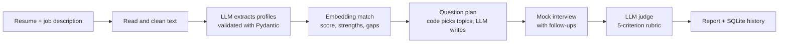

# 🎤 AI Interview Coach

A free, private AI coach that runs a **role-specific mock interview** from your resume and a job description. It finds where you match and where the gaps are, asks one question at a time with **follow-up questions**, and gives **rubric-based feedback** with weak and strong example answers.

Everything runs **locally on a laptop** with [Ollama](https://ollama.com), so personal resumes never leave the computer.

---

## ✨ Features

- 📄 Reads resumes as **PDF, Word or text**, and job descriptions as pasted text or a file
- 🧾 Extracts a **candidate profile** and a **job profile** as validated JSON
- 🗺️ **Matches skills by meaning** with embeddings: a match score, strengths and gaps
- ❓ Plans **8-10 role-specific questions**: project, technical, behavioural and gap questions, each with an answer key
- 💬 A **chat interview** that asks follow-up questions when key points are missing
- 🙋 Handles "Which project?" clarifications and "I don't know" answers
- 📊 Scores every answer on a **5-criterion rubric**, with what was good, what to improve, and example answers
- 📋 A **final report** with best and weakest answers and a practice list
- 📈 **History and progress** across interviews, saved in SQLite
- 🔁 Repeat interviews get **fresh questions**

## ⚙️ How it works



### Key design decisions

| Decision | Why |
|---|---|
| **Run everything locally** (Ollama + llama3.2) | Free, and resumes are personal data |
| **Structured outputs, checked in code** | The model gets the Pydantic JSON schema, every answer is validated, and invalid answers are retried once with the error message |
| **Code decides structure, the LLM writes language** | A small model failed at planning a whole interview in one call; code now picks topics and question types, and the model writes one question at a time |
| **Embeddings for skill matching** | "Built a RAG assistant" can match "experience with retrieval systems" even with different words |
| **Threshold chosen by experiment** | The match threshold (0.61) was set from labelled skill pairs, then re-tuned after finding a false match |
| **Code handles simple cases** | Very short answers and "I don't know" are handled without the LLM, so no feedback is invented |
| **Feedback at the end** | Scoring is the slowest step, so it runs once at the end with a progress bar |
| **Two temperatures** | 0.7 for writing varied questions, 0 for consistent scoring |

## 📏 Scoring rubric

Each answer is scored 1-5 on:

| Criterion | What it checks |
|---|---|
| Relevance | Does it answer every part of the question? |
| Structure | A clear order, for example STAR (Situation, Task, Action, Result) |
| Specifics | Concrete examples, numbers and results |
| Clarity | Easy to follow, not too long or vague |
| Technical accuracy | Correct use of concepts (skipped for behavioural questions) |

The LLM writes a reason before each score. Code calculates the averages.

## 📊 Evaluation results

### LLM judge vs. human scores
I wrote a test set of **30 sample answers** (strong, average and weak, including tricky ones such as confident-but-wrong and off-topic answers) for 6 questions, and **scored them myself** with a checklist. Then I compared the AI judge's scores with mine.

| Metric | Result |
|---|---|
| Within 1 point of the human score | **90%** (26/29) · target was 80% |
| Average difference | 0.57 points |
| Direction | -0.19 (slightly harsh) |

Findings:
- **Central tendency:** the judge avoids extreme scores (answers I scored 5 averaged 4.2, answers I scored 1 averaged 1.5)
- **Error analysis** showed that one of the four big disagreements was my own labelling mistake, which I corrected using the checklist
- **Run-to-run noise:** the same answer judged twice could differ by up to about 0.8 points

**Experiment: few-shot calibration examples.** Adding example answers for scores 5, 3 and 1 fixed the top end (5 of 8 excellent answers scored 5.0), but it over-penalised good-but-brief answers, and agreement **dropped to 83%**, so I **reverted** it. The examples used a different question than the test set, to avoid data leakage.

### Follow-up questions
On a fixed random sample of 20 answers:

| Version | Follow-up rate | Unnecessary follow-ups on complete answers |
|---|---|---|
| Model decides freely | 100% | 4 of 5 |
| Model lists missing key points first, code decides | **75%** | **2 of 5** |

An automatic "repeated question" check (embedding similarity) flagged 4 follow-ups, but a manual spot-check showed they were good: they asked vague or off-topic answers for a specific example. Proxy metrics still need human review.

## ⚠️ Known limitations

- A small local model sometimes invents facts in questions, or misreads answers
- Embeddings match the **topic** but not the **level** ("3+ years of Python" matches any Python)
- Achievements and summaries in resumes can be lost during extraction
- Scores vary by up to about one point between runs; treat them as guidance
- Slow on a laptop CPU: around 30-60 seconds per scoring call
- Not yet tested with real users

## 🚀 Setup

**Requirements:** Python 3.12, [Ollama](https://ollama.com), about 8 GB RAM.

```bash
git clone https://github.com/AnnMariaSabu/ai-interview-coach.git
cd ai-interview-coach
python -m venv .venv
.venv\Scripts\Activate.ps1
pip install -r requirements.txt
ollama pull llama3.2
ollama pull nomic-embed-text
streamlit run app.py
```

Settings such as the models, number of questions, follow-ups and thresholds are in `config.py`.

### Run the evaluations

```bash
python run_eval.py
python review_followups.py generate
python review_followups.py auto
```

## 📁 Project structure

| File | Purpose |
|---|---|
| `app.py` | Streamlit app: setup, interview, report and history |
| `config.py` | All settings in one place |
| `loaders.py` | Read and clean PDF, Word and text files |
| `llm.py` | Calls to the local model and embeddings |
| `schemas.py` | Pydantic data shapes |
| `extractor.py` | Candidate and job profiles, validation and retry |
| `matcher.py` | Embedding match, score, strengths and gaps |
| `planner.py` | Question topics and question writing |
| `interviewer.py` | Follow-up decisions |
| `scorer.py` | Rubric scoring |
| `report.py` | Final report (no LLM) |
| `database.py` | SQLite history |
| `run_eval.py`, `review_followups.py` | Evaluations |
| `data/samples/`, `data/evals/` | Fake sample resumes, job descriptions and eval data |

## 🔒 Privacy

All processing is local. Uploaded resumes are stored in `data/private/` and interview history in `data/interviews.db`; both are excluded from Git. All sample data in this repository is invented.

## 🌱 Future improvements

- Check answers for correctness before deciding on follow-ups
- A larger model, or several judge runs averaged, for more consistent scores
- Test with real users and collect ratings
- Easy, medium and hard interview levels
- Voice answers with Whisper

## 📚 What I learned

- Never trust LLM output blindly: validate structure with schemas, and handle failures
- Small models do better with small, clear tasks; let code handle rules and structure
- Measure before optimising, and measure after every change
- Evaluations need careful human labels, honest reporting, and an eye for noise
- Failed experiments are results too

---

Built by **Ann Maria Sabu** as a learning project, with Claude as a tutor explaining each step.